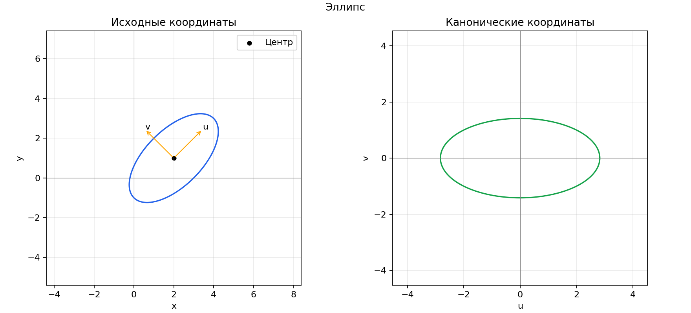

# Пример выполнения: повёрнутый эллипс

Это образец полностью ручного решения и оформления отчёта для раздела II. Матрицы и программирование не нужны. Для самостоятельной работы преподаватель может назначить другой вариант.

## 1. Исходное уравнение

$$
5x^2-6xy+5y^2-14x+2y-3=0.
$$

## 2. Полярная замена и угол поворота

Положим $x=r\cos\theta$, $y=r\sin\theta$. Тогда

$$
r^2(5-3\sin2\theta)+r(-14\cos\theta+2\sin\theta)-3=0.
$$

Выберем $\theta=\psi+\pi/4$. Это соответствует повороту осей на $45^\circ$. Так как $\sin(2\psi+\pi/2)=\cos2\psi$, квадратичная часть станет

$$
r^2(5-3\cos2\psi)
=r^2(2\cos^2\psi+8\sin^2\psi).
$$

Вернёмся к декартовым координатам относительно повёрнутых осей: $s=r\cos\psi$, $t=r\sin\psi$. Получаем замену

$$
x=\frac{s-t}{\sqrt2},\qquad y=\frac{s+t}{\sqrt2}.
$$

После подстановки в полное уравнение:

$$
2s^2+8t^2-6\sqrt2s+8\sqrt2t-3=0.
$$

Смешанный член исчез: в полученном уравнении нет произведения $st$.

## 3. Выделение полных квадратов и центр

Сгруппируем слагаемые:

$$
2\left(s-\frac{3\sqrt2}{2}\right)^2
+8\left(t+\frac{\sqrt2}{2}\right)^2=16.
$$

Центр в повёрнутых координатах: $s_0=3\sqrt2/2$, $t_0=-\sqrt2/2$. Подставим в формулы поворота:

$$
x_0=\frac{s_0-t_0}{\sqrt2}=2,\qquad y_0=\frac{s_0+t_0}{\sqrt2}=1.
$$

Вводим $u=s-s_0$, $v=t-t_0$. Значит, новое начало координат — точка $(2,1)$.

## 4. Замена координат и канонический вид

Прямая замена:

$$
x=2+\frac{u-v}{\sqrt2},\qquad y=1+\frac{u+v}{\sqrt2}.
$$

Обратная замена:

$$
u=\frac{x+y-3}{\sqrt2},\qquad v=\frac{-x+y+1}{\sqrt2}.
$$

После подстановки:

$$
2u^2+8v^2-16=0
\quad\Longleftrightarrow\quad
\boxed{\frac{u^2}{8}+\frac{v^2}{2}=1}.
$$

Это эллипс с центром $(2,1)$ в исходных координатах. Полуоси равны $a=2\sqrt2$ вдоль новой оси $u$ и $b=\sqrt2$ вдоль новой оси $v$. Полные длины осей — $2a$ и $2b$, не путайте их с полуосями.

## 5. Контрольные точки

| Каноническая точка $(u,v)$ | Исходная точка $(x,y)$ | Значение исходного полинома |
|---|---|---:|
| $(2\sqrt2,0)$ | $(4,3)$ | 0 |
| $(-2\sqrt2,0)$ | $(0,-1)$ | 0 |
| $(0,\sqrt2)$ | $(1,2)$ | 0 |
| $(0,-\sqrt2)$ | $(3,0)$ | 0 |

Например, для $(4,3)$: $80-72+45-56+6-3=0$.

## 6. График и вывод

Слева показан эллипс в исходных координатах, чёрная точка — центр, оранжевые стрелки — новые оси. Справа оси эллипса совпадают с координатными. Геометрическая кривая не изменилась: мы сменили начало координат и направления осей. Поворот и перенос сохраняют длины, углы и форму.

**Вывод для отчёта:** полярная запись позволила выбрать угол поворота, после которого исчез смешанный член; линейные члены исчезли после переноса в центр. Проверка четырьмя точками и построение графиков подтверждают полученный канонический вид.

Для собственного варианта сделайте два аналогичных рисунка от руки или в графическом калькуляторе. Программно повторять иллюстрацию не требуется.
